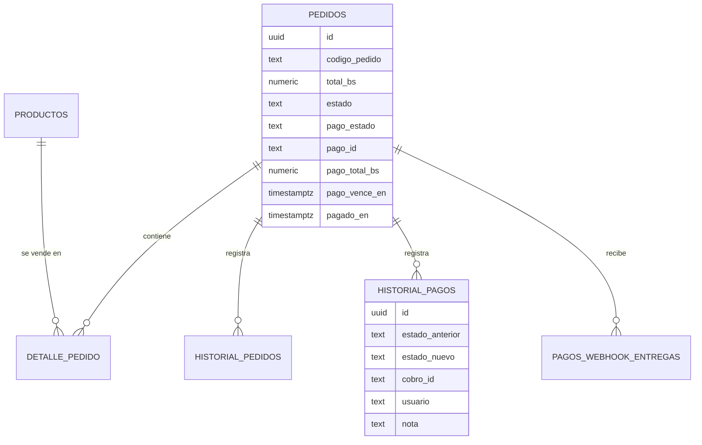
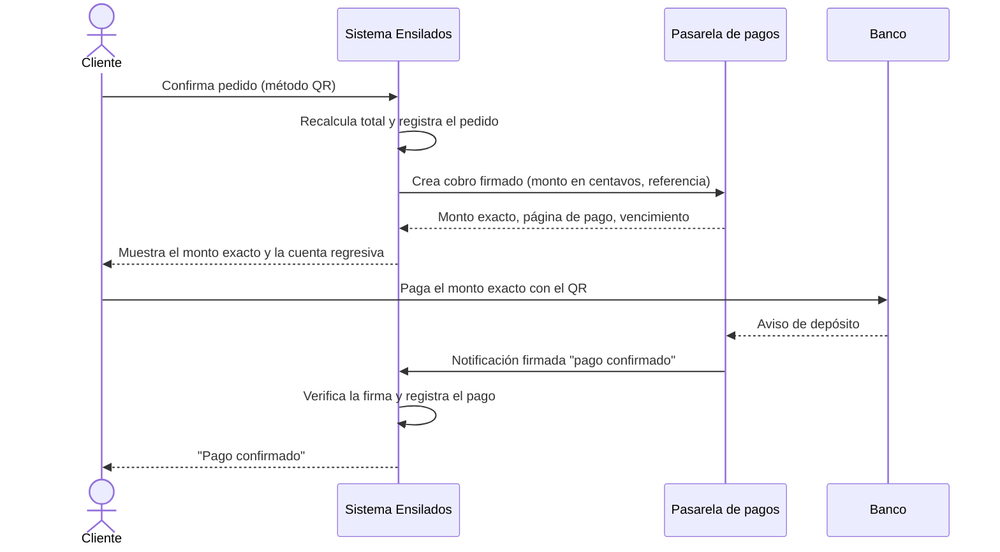
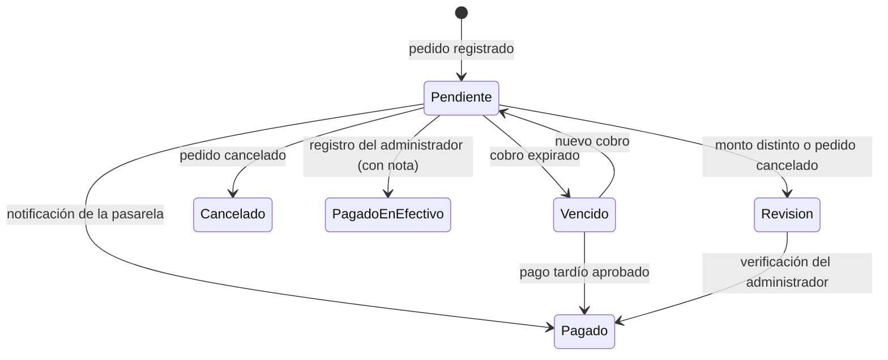

# Cambios a incorporar en la tesis

Texto en español académico (normas APA, 7.ª edición) para agregar al documento de la tesis. Los números de sección,
tabla y figura son orientativos: ajústelos a la numeración del documento. **Revise el Sprint asignado** (sección 5)
contra la planificación real de la tesis.

---

## 1. Nueva historia de usuario: HU10 — Pago del pedido mediante código QR

**Como** cliente de Ensilados Santa Cruz, **quiero** pagar mi pedido escaneando un código QR desde la aplicación de mi
banco y recibir la confirmación automática del pago, **para** completar la compra sin trasladarme a la planta ni enviar
comprobantes por mensajería.

**Prioridad:** alta. **Estimación:** 8 puntos de historia. **Rol secundario:** administrador (seguimiento y registro
manual de pagos).

### 1.1 Descripción

La empresa dispone de un código QR bancario estático, que no lleva el monto. Para identificar cada pago, el sistema
se integra con una pasarela de pagos propia. La pasarela asigna a cada cobro un monto exacto y único: el total del
pedido más un centavo libre (por ejemplo, Bs 3.035,35 → Bs 3.035,36). Después concilia los avisos de depósito del banco
con los cobros pendientes. Cuando reconoce un pago, notifica al sistema mediante un *webhook*: una petición HTTP
firmada criptográficamente con HMAC-SHA256 (Krawczyk et al., 1997; National Institute of Standards and Technology
[NIST], 2015). Con esa notificación, el pedido queda registrado como pagado. El estado de pago se gestiona por separado
del estado logístico del pedido, de modo que la entrega y el cobro avanzan de forma independiente.

### 1.2 Criterios de aceptación

| N.º | Dado | Cuando | Entonces |
|---|---|---|---|
| CA1 | un cliente con productos en el carrito y método de pago QR | confirma el pedido | el sistema registra el pedido, crea el cobro con el total **calculado por el servidor** y muestra en grande el monto exacto a pagar, un acceso al QR del banco y una cuenta regresiva |
| CA2 | un cobro pendiente | el cliente paga exactamente el monto indicado | en un máximo de dos minutos la pantalla muestra "Pago confirmado" y el pedido figura como *Pagado* en el panel |
| CA3 | un cliente que modifica el total en el navegador | envía el pedido | el sistema ignora el importe recibido y cobra el total recalculado |
| CA4 | una notificación con firma inválida, con más de cinco minutos de antigüedad o repetida | llega al sistema | se rechaza (401) o se ignora sin modificar el pedido |
| CA5 | la pasarela no está disponible | el cliente confirma el pedido | el pedido se registra como *Pendiente de pago* y el cliente dispone del botón "Reintentar pago" |
| CA6 | un cobro vencido | el cliente desea pagar | el sistema genera un cobro nuevo y el vencimiento del anterior no afecta al pedido |
| CA7 | un pedido con cobro pendiente | el administrador lo cancela | el cobro se anula en la pasarela, el stock se repone y el pago queda *Cancelado* |
| CA8 | un pago en efectivo recibido en planta | el administrador lo registra | el sistema exige una nota, guarda el usuario y la fecha en el historial y marca el pedido como *Pagado en efectivo* |
| CA9 | un pago con monto distinto o sobre un pedido cancelado | la pasarela lo notifica | el pago queda *En revisión* y nunca se confirma automáticamente |
| CA10 | el administrador consulta los reportes | filtra por fechas | obtiene las ventas pagadas frente a las pendientes en el panel, en PDF y en CSV |

---

## 2. Cambios al modelo de datos

**Tabla `pedidos`** (columnas nuevas):

| Columna | Tipo | Descripción |
|---|---|---|
| `pago_estado` | TEXT | Pendiente, Pagado, Pagado en efectivo, Vencido, Cancelado o Revision |
| `pago_id` | TEXT | Identificador del cobro en la pasarela |
| `pago_total_bs` | NUMERIC(14,2) | Monto exacto del cobro (total + centavo único) |
| `pago_checkout_url` | TEXT | Página de pago de la pasarela |
| `pago_vence_en` | TIMESTAMPTZ | Vencimiento del cobro |
| `pago_intentos` | INT | Número de cobros generados |
| `pagado_en` | TIMESTAMPTZ | Fecha de confirmación del pago |

**Tablas nuevas:**

- `historial_pagos` (id, pedido_id, estado_anterior, estado_nuevo, cobro_id, usuario, nota, creado_en): trazabilidad de
  cada cambio del estado de pago y de su origen (pasarela, consulta o administrador).
- `pagos_webhook_entregas` (entrega_id, evento, pedido_id, recibido_en): garantiza que cada notificación se procese una
  sola vez (idempotencia).

**Función nueva** `registrar_pago_pedido`: aplica en una sola transacción el registro de la notificación, el cambio de
estado y el historial. Bloquea la fila del pedido para evitar condiciones de carrera y no permite degradar un pago ya
confirmado.

**Seguridad:** todas las tablas mantienen la seguridad a nivel de fila (RLS) sin políticas para los roles públicos. El
navegador no accede a la base de datos.

### Figura sugerida — Modelo entidad-relación (extracto)

---

## 3. Diagramas

### Figura sugerida — Diagrama de secuencia del pago con QR

### Figura sugerida — Estados del pago

---

## 4. Pruebas realizadas

Se ampliaron las pruebas automatizadas del servidor de 25 a **46 casos**, ejecutados con el corredor nativo de Node.js
(`node:test`). Los **46 casos** fueron **aprobados**. Para el módulo de pagos se empleó una pasarela simulada que
reproduce el contrato de la pasarela real: firma de peticiones, código de un solo uso (*nonce*), centavo único, página de
pago y notificaciones firmadas.

### Tabla sugerida — Pruebas del módulo de pago con QR

| N.º | Caso de prueba | Resultado esperado | Resultado |
|---|---|---|---|
| P1 | Firma de petición y de notificación con los vectores oficiales de la pasarela | Coinciden con los valores publicados | Aprobado |
| P2 | Creación del cobro al registrar el pedido, con total alterado por el cliente | Se cobra el total recalculado en el servidor | Aprobado |
| P3 | Conversión a centavos (0,29; 1,005; 4500,1; 123 456,78) | Centavos exactos, sin error de coma flotante | Aprobado |
| P4 | Notificación válida de pago | Pedido *Pagado* | Aprobado |
| P5 | Firma inválida, secreto ajeno, cuerpo alterado, marca de tiempo antigua | Rechazo 401, sin cambios | Aprobado |
| P6 | Notificación repetida | Se ignora; el historial no se duplica | Aprobado |
| P7 | Pasarela no disponible (503) o saturada (429) | Pedido *Pendiente de pago*; reintento exitoso al recuperarse | Aprobado |
| P8 | Cancelación de pedido con cobro pendiente | Cobro anulado en la pasarela, stock repuesto | Aprobado |
| P9 | Pago tardío de un cobro vencido | Se acepta y se anula el cobro nuevo | Aprobado |
| P10 | Pago con monto distinto o sobre pedido cancelado | Estado *En revisión* | Aprobado |
| P11 | Registro de pago en efectivo sin nota / con nota | Rechazo / *Pagado en efectivo* con historial | Aprobado |
| P12 | Respaldo por consulta sin notificación | Estados actualizados desde la pasarela | Aprobado |
| P13 | Integración HTTP completa con la pasarela simulada | Cobro, pago y notificación de extremo a extremo | Aprobado |

Además se realizaron:
- **Pruebas de base de datos.** Se ejecutaron sobre PostgreSQL 15 con la misma imagen de Supabase de producción. El
  esquema se aplicó dos veces sin errores (idempotencia) y se probó la migración desde la versión anterior. También se
  comprobó que el rol público no puede leer tablas ni ejecutar funciones.
- **Pruebas de extremo a extremo** con un navegador automatizado (Playwright) en escritorio y en teléfono, con tema claro
  y oscuro del sistema operativo. Se recorrió la compra con pago QR hasta "Pago confirmado" y el panel administrativo
  con doble factor. También se verificó que un nombre de cliente con código HTML (`<script>`) se muestra como texto y no
  se ejecuta.
- **Verificación de seguridad.** Se comprobó que el límite de peticiones se aplica por la IP real de cada cliente, que el
  origen cruzado (CORS) está restringido y que las dependencias no presentan vulnerabilidades altas ni críticas.

> **Pendiente para la tesis:** registrar la **prueba real** con un pedido de bajo monto pagado con el QR (ver la lista
> de verificación de `docs/DESPLIEGUE-COOLIFY.md`), con fecha, monto, tiempo hasta la confirmación y captura de pantalla.

---

## 5. Ubicación en la planificación Scrum

Se sugiere incorporar la HU10 al **Sprint 4** como incremento de cierre (integración y pagos). Si el Sprint 4 ya está
completo en la planificación, regístrela como un **Sprint 5 de mejora** o como trabajo del *Product Backlog* refinado.
Tareas del Sprint (Schwaber y Sutherland, 2020):

| Tarea | Puntos |
|---|---|
| Cliente firmado de la pasarela y creación del cobro | 2 |
| Notificaciones (webhook) con verificación de firma e idempotencia | 2 |
| Modelo de datos, función atómica e historial de pagos | 1 |
| Interfaz de pago (monto exacto, cuenta regresiva, reintento) | 1 |
| Panel administrativo y reportes de cobranza | 1 |
| Pruebas automatizadas, de extremo a extremo y despliegue | 1 |

---

## 6. Referencias (agregar a la lista de la tesis)

Krawczyk, H., Bellare, M., y Canetti, R. (1997). *HMAC: Keyed-hashing for message authentication* (RFC 2104).
Internet Engineering Task Force. https://doi.org/10.17487/RFC2104

National Institute of Standards and Technology. (2015). *Secure hash standard (SHS)* (FIPS PUB 180-4).
https://doi.org/10.6028/NIST.FIPS.180-4

Schwaber, K., y Sutherland, J. (2020). *La guía de Scrum: La guía definitiva de Scrum: Las reglas del juego*.
https://scrumguides.org
